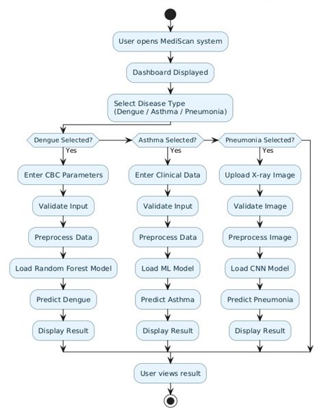
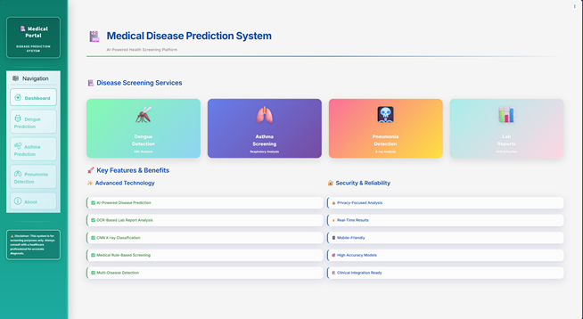
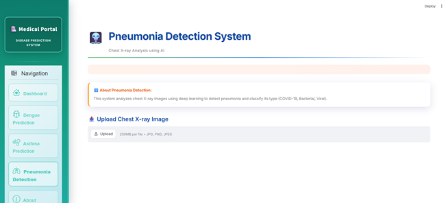
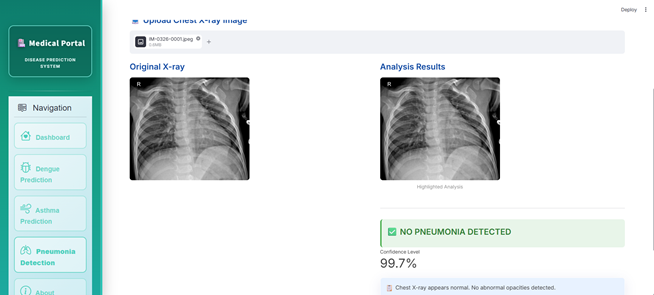
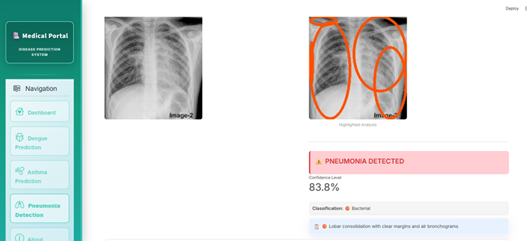
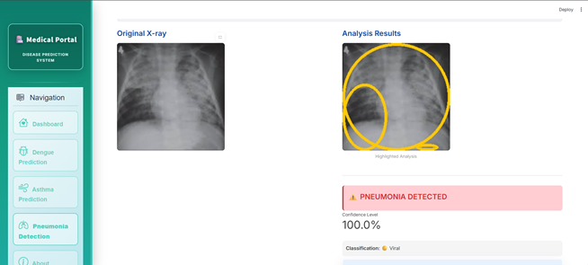
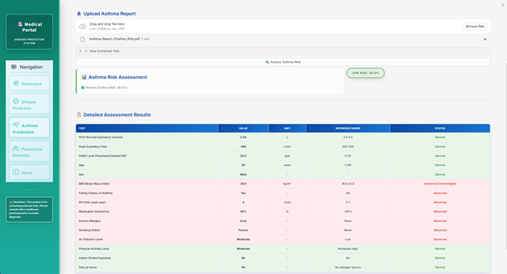
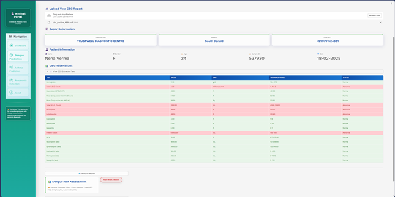
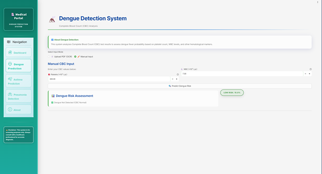

# 🩺 MediScan: Multimodal AI Diagnostic Engine  
[](https://www.python.org/) 
[](https://www.tensorflow.org/) 
[](https://scikit-learn.org/) 
[](https://opensource.org/licenses/MIT)  

---

## 📖 Overview  
**MediScan** is an end-to-end clinical decision support system designed for the early detection of **Asthma, Dengue, and Pneumonia**. Built to tackle the complexity of multimodal medical data, it bridges the gap between raw clinical inputs (blood reports, X-rays, spirometry) and actionable diagnostic insights.  

The project focuses on moving beyond single-disease silos to provide a unified, explainable framework for patient diagnostics.  

---

## ✨ Key Features  

- **Multimodal Diagnostics:** Processes tabular clinical data, imaging, and PDF lab reports  
- **Automated Data Extraction:** OCR-based CBC report parser with median imputation  
- **Explainable AI Integration:** Feature importance ranking for transparency  
- **Secure Architecture:** Role-based access (Patients, Doctors, Admins)  
- **Automated Reporting:** Downloadable PDF/CSV diagnostic summaries  

---

## 🧠 Machine Learning Pipelines  

### 1. Pneumonia Detection (Computer Vision)  
- **Architecture:** CNN with VGG19 (Transfer Learning)  
- **Data:** Chest X-ray images  
- **Preprocessing:** OpenCV normalization + Keras augmentation  
- **Performance:** **92.15% test accuracy**, up to **99.9% confidence**  

### 2. Dengue Prediction (Tabular + OCR)  
- **Architecture:** Random Forest Classifier  
- **Data:** CBC parameters (platelets, WBC, lymphocytes, hematocrit)  
- **Performance:**  
  - **91.80% test accuracy**  
  - **93.77% cross-validation score**  
  - Outperformed SVM & XGBoost  

### 3. Asthma Risk Assessment  
- **Architecture:** Random Forest Pipeline  
- **Data:** Spirometry + clinical data (FEV1, FeNO, Peak Flow, BMI, environment)  
- **Insights:**  
  - FEV1 → **32% importance**  
  - FeNO → **28% importance**  
- **Performance:** **>90% accuracy**  

---


## 🛠️ System Architecture  


---

## 🖼️ Screenshots  










 

---

## 🛠️ Tech Stack  

- **Machine Learning:** Python, TensorFlow, Keras, Scikit-Learn  
- **Data Processing:** Pandas, NumPy, OpenCV  
- **Frontend:** Streamlit / React  
- **Backend:** FastAPI / Flask  

---

## 🚀 Installation & Local Setup  

```bash
# 1. Clone the repository
git clone https://github.com/Hussain-Tinwala/MediScan.git

# 2. Navigate to the project directory
cd Multiple-Disease-Prediction-Webapp

# 3. Create a virtual environment (Recommended)
python -m venv venv

# Activate environment
# On Linux/Mac:
source venv/bin/activate

# On Windows:
venv\Scripts\activate

# 4. Install dependencies
pip install -r requirements.txt

# 5. Run the application
streamlit run Multiple-Disease-Prediction-Webapp/Frontend/app.py